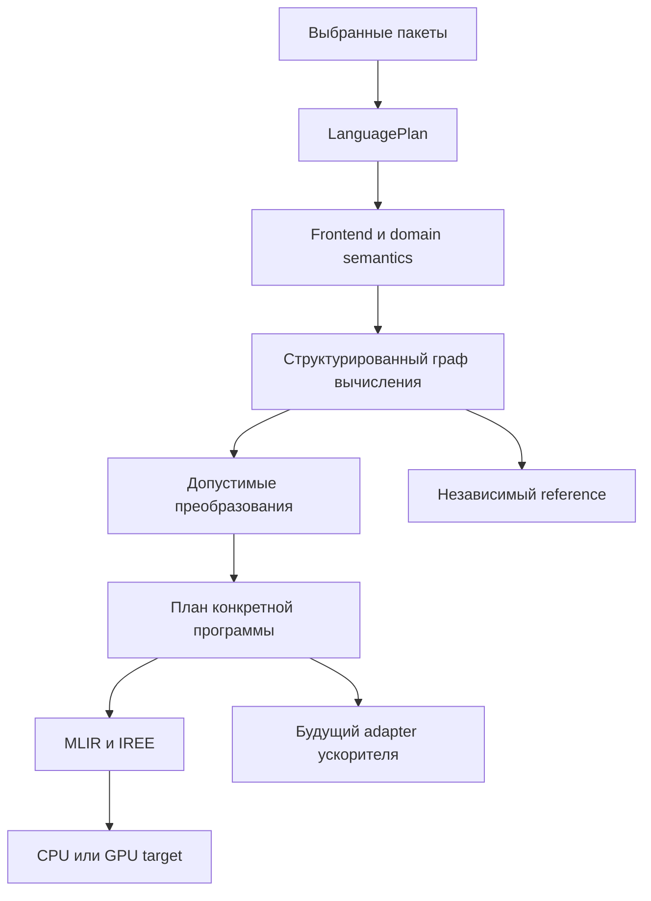

# UniversalToolchain: специализация на переносимых вычислительных DSL

**Статус: dated-review и архитектурное предложение, 2026-10-26.** Аудит исходников основан на `de0da4a81b1ce38fc296f9de7b1e9ad10515f9a1`. Этот документ не объявляет CPU/GPU/TPU backend реализованным, не обещает ускорения и не вводит новый публичный API. Выполненные исправления и проверки перечислены отдельно в [VALIDATION.md](VALIDATION.md).

**Уточнение приоритетов:** [бизнес- и научная переоценка](BUSINESS_AND_RESEARCH_STRATEGY.md) рассматривает проект целиком. Ближайший научный результат опирается на существующий CGO27, практическая ценность проверяется одним внешним пилотом. Численная CPU/GPU ветка ниже — условный инженерный эксперимент; её продуктовый приоритет пока не подтверждён.

## Решение

**Перспективная специализация — framework для предметных вычислительных DSL с явной семантикой, проверяемыми расширениями и несколькими способами исполнения.** Для первого аппаратного эксперимента следует использовать существующий стек MLIR/IREE и сравнить интеграцию через UT с прямым подключением того же стека. Самостоятельная разработка всех CPU/GPU/тензорных backend сейчас не обоснована.

Нужны семантические контракты операций, чисел, памяти и преобразований. Часть этой основы в UT уже существует. **Общий FactStore, универсальная онтология и вывод произвольных фактов не являются предварительным условием переносимого DSL.** Их продвижение в production остаётся закрыто до реального опыта, в котором обычные типизированные C#-интерфейсы и существующие средства backend оказываются недостаточными.

Это продолжение [Ideal UT dossier](../ideal-ut-2026-10-08/README.md), а не новая параллельная программа из сотен обязательных задач. Полные ответы на прежние вопросы и согласование исследовательских веток находятся в [RESEARCH_ANSWERS.md](RESEARCH_ANSWERS.md). Следующий проверяемый шаг определён в [EXPERIMENT_PLAN.md](EXPERIMENT_PLAN.md).

Чтобы превратить этот выбор в ближайшее ТЗ, см. [SPEC_RESEARCH_PLAN.md](SPEC_RESEARCH_PLAN.md): два предварительных исследования, четыре ограниченных этапа первой итерации, обнаруженные API-границы и связь evidence с конкретными требованиями.

## 1. Что действительно есть в проекте

| Область | Подтверждено исходниками | Граница утверждения |
|---|---|---|
| Композиция языка | `LanguageCompiler` разрешает features/contributions, строит immutable `LanguagePlan`; runtime материализует выбранные компоненты | Это план конфигурации языка, а не оптимальный граф исполнения каждой программы |
| Семантические описания | `CallableDescriptor`, сигнатуры, effects, determinism, algebraic traits, trust labels | Метаданные и уровень доверия сами не доказывают истинность закона |
| Стандартная семантика | Типы bool/int32/float64, небольшой набор unchecked-int32 callables | Нет полного числового контракта тензоров, BF16/TF32, редукций и ошибок округления |
| SSA | Callable-based SSA, dominance/use-def verification, constant folding, SCCP-lite, branch/dead-code cleanup | Межблочная оптимизация уже есть; heterogenous scheduling и универсальная семантическая эквивалентность не реализованы |
| Контракты проходов | Required/produced/preserved/invalidated facts/capabilities, повторные проверки границ | `IrFactSet` — набор ID, не общий revision-aware proof calculus |
| Исполнение | AIR interpreter и CIL; CIL использует CLR/JIT | Рабочий CPU-путь не означает самостоятельный native CPU backend или поддержку GPU |
| TensorRules | Второй исследовательский язык с shape/type/policy проверками | Результат вида `2x4:row` описывает метаданные; численный matmul и аппаратный kernel отсутствуют |
| Проверка композиции | PlanFuzz: структурированные генераторы, differential/configuration oracles, replay/reduction | Превосходство над равнобюджетным обычным fuzzing пока не доказано |

Привязки к исходникам: [LanguageCompiler](../../../UniversalToolchain/UniversalToolchain.LanguageSdk/LanguageCompiler.cs), [route search](../../../UniversalToolchain/UniversalToolchain.LanguageSdk/LanguageArtifactRoutePhase.cs), [semantic descriptors](../../../UniversalToolchain/UniversalToolchain.Semantics.Abstractions/SemanticDescriptors.cs), [standard semantics](../../../UniversalToolchain/UniversalToolchain.StandardSemantics/StandardSemanticDescriptors.cs), [SSA contracts](../../../docs/architecture/callable-first-ssa.md), [TensorRules](../../../UniversalToolchain/Experiments/UniversalToolchain.TensorRules/README.md), [PlanFuzz status](../../proposals/planfuzz/implementation-status.md). Текущую архитектурную власть сохраняет [CURRENT_ARCHITECTURE_STATUS](../../../docs/CURRENT_ARCHITECTURE_STATUS.md).

Практический предел существующего SSA-пути: emitter в стековый AIR ещё отклоняет повторные использования значений, требующие duplication/spills; поэтому local CSE ограничен. Расширять оптимизатор без согласования с emitter нельзя. Но новая тензорная ветка не обязана проходить через стековый AIR: generic SDK уже допускает другие типизированные артефакты.

## 2. Какие прежние результаты меняют выбор

1. [Разбор 23 октября](https://github.com/Misha1302/UniversalToolchain/blob/a1e5f25bf0afd7850075ed4aeafc8b2a48c6c99d/internal-docs/research/ideal-ut-2026-10-08/SEMANTIC_COMPOSITION_FINDINGS.md) уже отвергает преждевременную поставку общего семантического ядра. Его прямой C#-контроль повторно выполнен 26 октября: 12/12 проверок, неизменённый исходный consumer, совпавший hash вывода. Это boolean decision control с заранее известным `ISafeIndexQuery`, не реальное удаление bounds check и не proof of soundness.
2. [Library-first pilot 20 октября](https://github.com/Misha1302/UniversalToolchain/blob/d7cfc45b25586ddf0fd5dac4e24a4c0c818bb4c9/internal-docs/research/semantic-evidence/library-first-2026-10-20/docs/00_DECISION.md) разрешает ограниченный эксперимент, а не release. Его не нужно отменять или объявлять реализованным: сначала нужны реальный UT consumer, внешний consumer и сопоставимый direct-C# baseline.
3. [DSL evolution study](https://github.com/Misha1302/UniversalToolchain/blob/01e0a85d9b9742b3654476ec360f98d5d4027819/internal-docs/research/dsl-evolution-study/RESULTS.md) показывает смешанную экономику расширений: уменьшение marginal LOC не доказывает уменьшения total LOC. Ссылки на точные файлы и ограничения измерений приведены в таблице corpus в [RESEARCH_ANSWERS.md](RESEARCH_ANSWERS.md); это историческое исследование, в этой работе оно не перезапускалось.
4. [Trust-boundary study](https://github.com/Misha1302/UniversalToolchain/tree/34707feb85e976ce879c1342f4b0a84f0a110ae7) показывает опасность вручную принятого ложного `Pure`, но содержит отрицательный контроль: stock SSA profile сохраняет тот же effectful call. Нельзя превращать это в заявление о доказанной небезопасности стандартного Wist.

Главный вывод: **проекту нужен реальный вычислительный пример, который различает архитектурные альтернативы. Ещё один пример успешного комбинирования заранее заданных флагов этого не сделает.**

## 3. Оценка сценариев развития

| Сценарий | Для чего полезен | Решение и условие |
|---|---|---|
| Усилить текущий .NET DSL SDK, диагностику и воспроизводимость | Ближайшая практическая ценность на существующем коде | Продолжать; устранять реальные нарушения контрактов и снижать стоимость внешнего языка |
| Один численный DSL, CPU reference и MLIR/IREE CPU/GPU route | Проверка сильной технической специализации | Следующий срез при выборе аппаратной ветки; выбрать workload и сравнить с direct DSL→тот же backend |
| Проверяемые расширения, CGO27 reverification и PlanFuzz | Конкретная основа исследовательского вклада | Усилить независимость и baseline существующего исследования; GPU-срез не является предварительным условием |
| Общий semantic evidence service | Несколько независимых consumers с повторным использованием и отзывом фактов | Только после измеренной потребности; typed query interfaces первыми |
| Собственный универсальный компилятор уровня MLIR | Полный контроль над огромной инфраструктурой | Сейчас не выбирать: нет workload/evidence, оправдывающего стоимость |
| Одновременно все GPU, TPU, NPU и FPGA | Широкий маркетинговый охват | Не включать в первый этап; каждый target требует конкретного runtime, subset и реальных проверок |

Это качественная оценка по архитектурному соответствию и проверяемости, а не численный рейтинг рынка. Настоящая пользовательская нагрузка, SLA и набор целевых устройств в запросе не определены. Предложенные workloads — проверяемые кандидаты, не доказанная специализация бизнеса.

## 4. Что означает «один код для разных процессоров»

Нужно переносить **смысл вычисления**, оставляя возможность менять его **расписание и представление данных**. Например:

```text
Y = activation(matmul(X, W) + bias)
```

Это спецификация операции. CPU-реализация может использовать cache blocking, SIMD и библиотечный GEMM; GPU — workgroups, shared memory и матричные инструкции; отдельный тензорный процессор — свою иерархию памяти и runtime. Форма алгоритма общая, но оптимальные tile sizes, layout, параллелизм и доступ к памяти различаются.

Если в исходной семантике уже зашиты CUDA warp operations, конкретный shared-memory layout и барьеры, перенос на CPU может потребовать эмуляции. Корректный запуск не гарантирует скорость. Аналогичное разделение algorithm/schedule существует в [Halide](https://halide-lang.org/); [Pallas](https://docs.jax.dev/en/latest/pallas/index.html) прямо описывает разные hardware-specific API для GPU и TPU.

Также необходимо различать матричные блоки внутри GPU, Google TPU и другие NPU. Они не образуют один backend с одинаковым ABI, списком типов и моделью памяти. Экспорт StableHLO сам по себе не подтверждает исполнение на конкретном TPU.

## 5. Какое семантическое ядро действительно нужно

### Уровень A: смысл операций — обязателен

Развивать существующую descriptor foundation, а предметную часть размещать в выбранных domain packages. Для конкретной операции должны быть определены:

- типы, shape constraints, broadcasting, индексация и допустимые входы;
- значения результата и reference behavior для пограничных случаев;
- effects, aliasing, ownership, lifetime и порядок наблюдаемых действий;
- overflow/traps, NaN, infinities, signed zero, разрешение FMA и reassociation;
- reduction order, accumulation dtype, quantization и допустимая ошибка;
- legal lowerings с проверяемыми предусловиями и явным отказом;
- правила проверки и transport при смене IR.

Семантика принадлежит автору операции и выбранному числовому домену. Backend сообщает реализацию и её условия применимости. Generic framework не должен знать названия `matmul`, Wist, NVIDIA или конкретного product profile.

### Уровень B: scoped queries — по необходимости

Первый работающий optimizer может получать shape/range/effects через обычные типизированные C#-интерфейсы. Каждый safety-sensitive ответ привязывается к конкретному immutable program snapshot, точке программы, target, числовой политике и доверенному provider. После изменения IR проще сначала пересчитать анализы, чем обещать правильную selective invalidation.

`Unknown` запрещает зависимое преобразование. Отрицательное знание, отсутствие ответа и конфликт не следует смешивать. Для одного consumer может быть достаточно conservative result + диагностики; необходимость общего четырёхзначного public API нужно подтвердить независимыми consumers.

### Уровень C: общий вывод фактов — условный

Evidence broker полезен, если несколько независимых consumers используют одни и те же факты и их отзыв, а direct interfaces создают измеренную дублирующую связность. Finite monotone rules/Datalog добавлять ещё позже, при реальной транзитивной задаче. Provenance объясняет вывод, но не удостоверяет ложную предпосылку. Schema-valid descriptor, hash конфигурации и self-declared trust level не заменяют проверку реализации.

Новая категория фактов не научит старый optimizer неизвестному преобразованию. Нужен существующий query hook, новый transform или явный adapter; их стоимость включается в оценку расширяемости.

## 6. Расширяемая архитектура аппаратного среза

Ниже — **предлагаемые роли**, не названия новых поставляемых типов:



`LanguageCompiler` сохраняет единоличное право выбирать packages/providers/routes/policy. План конкретной программы выбирает fusion/layout/schedule **внутри этого уже выбранного мира**. Runtime не обнаруживает скрыто новый backend и не пересобирает конфигурацию языка. Для смешанного CPU/GPU исполнения потребуется отдельный явно выбранный executor/adapter с описанными вариантами и dispatch policy: нынешнюю маршрутизацию нельзя считать готовым heterogeneous runtime.

Сохранять tensor/map/reduce/matmul/region structure следует до принятия решений, которым она нужна. Обязательный ранний перевод в stack AIR/CIL разрушит полезные сведения о shapes и dataflow. Внутри численного домена разумно принять общую структурированную IR; representation neutrality всего framework не требует отказаться от общей IR там, где она полезна.

На первом этапе желательно позволить IREE владеть buffers и scheduling внутри выбранного device/runtime, а UT — domain-specific преобразованиями, контрактами, package composition и reproducible artifact boundary. Это не предположение о готовом оптимальном разделении произвольного графа между CPU и GPU. Дублирование планировщика IREE оправдывается только отсутствующей конкретной функцией.

### Контракт расширения

| Автор расширения | Что поставляет | Чего не делает |
|---|---|---|
| Domain operation | Семантика, verifier/reference behavior, versioned shape/effect contracts | Не объявляет `Pure` только ради оптимизации |
| Analysis | Scoped typed answer с условиями и invalidation requirements | Не меняет выбранные packages |
| Transform | Preconditions, guarded rewrite, проверка результата, mapping/invalidation | Не принимает Unknown за разрешение |
| Backend adapter | Legal subset, lowering, ABI, target capabilities, диагностируемый отказ | Не объявляет все типы/режимы поддержанными по одному boolean |
| Host | Trust/resource policy до сборки LanguagePlan, разрешённые устройства и явная dispatch policy | Не выдаёт measured cost за доказательство корректности |

У capabilities полезно отличать native implementation, legal emulation, explicit fallback и unsupported. Быстродействие хранится отдельно. Один target может поддерживать FP32 map, но не нужный BF16 reduction с данным accumulation order.

## 7. Что оптимизировать глобально

Текущий `ArtifactTransformationDescriptor.Cost` — заданная автором неотрицательная стоимость шага маршрута. Сумма таких costs не описывает latency конкретной программы. Уже имеющийся SCCP-lite работает между basic blocks, но не выбирает устройства и размещение тензоров.

Для полного графа важны:

1. Выбор алгоритма и библиотечного вызова против собственного kernel.
2. Fusion нескольких операций и удаление промежуточных массивов.
3. Layout propagation, устранение ненужных transpose/copy.
4. Повторное использование buffers с проверкой liveness и aliasing.
5. Размещение данных, host/device transfers и сохранение residency между вызовами.
6. Синхронизация, overlap передач и вычислений, peak memory.
7. Специализация по shape, dtype, target и известным параметрам.
8. Tiling, vectorization, register/shared-memory pressure и launch geometry внутри выбранного kernel.

Например, отдельные быстрые kernels для matmul, bias и activation могут проиграть одному fused варианту из-за лишнего чтения/записи промежуточных результатов. Но fusion может увеличить register pressure или лишить программу быстрого library kernel. Решение принимается по всему pipeline. Такие возможности уже есть в [XLA GPU pipeline](https://openxla.org/xla/gpu_architecture), поэтому сами по себе они не являются новым свойством UT.

Для последовательного пути полезна модель `T_end_to_end = T_host + T_transfers + T_launches + T_compute + T_sync`; при overlap оценивать critical path ресурсного DAG, а не складывать перекрывающиеся интервалы. Cold cost дополнительно включает планирование, компиляцию и autotuning. Оптимизировать нужно заранее выбранный критерий: например p95 latency при ограничении памяти, либо throughput при заданном numerical contract.

**Глобальная оптимизация здесь означает выбор по всему графу, а не гарантию глобального математического оптимума.** Начать с bounded beam/greedy/динамического поиска в ограниченной области, сохранять baseline и журнал причин выбора. Cost model отсекает кандидатов; ключевые решения измеряются на целевом оборудовании. [TVM MetaSchedule](https://tvm.apache.org/docs/deep_dive/tensor_ir/tutorials/meta_schedule.html) — сильный готовый ориентир для разделения search space, strategy, model и measurement database.

### E-graphs

Equality saturation уместна для небольших чистых областей с точными допустимыми равенствами. Она не заменяет alias analysis, model of effects, hardware scheduler или память runtime. В [egg](https://docs.rs/egg/latest/egg/struct.Runner.html) есть отдельные бюджеты времени, числа узлов и итераций; выбранный результат ограничен представленными вариантами и cost function.

Для DAG необходимо учитывать sharing, materialization и liveness: минимальная сумма стоимости дерева может дать плохой план памяти. Приблизительное равенство с допуском epsilon не транзитивно, поэтому approximate rewrites нельзя безусловно объединять как обычные e-class equalities. Нужны отдельная разрешённая числовая семантика или compositional error bounds.

## 8. Численная корректность и трудные границы

Общий `Associative` недостаточен. Unchecked int32 addition допускает правила, которые неверны для checked arithmetic и для произвольного IEEE float. Перенос reduction на GPU меняет порядок операций; использование матричных инструкций может менять precision и accumulation. Эти изменения должны быть разрешены контрактом программы.

Предлагаются раздельные режимы: строгая семантика операций; отдельно заданная воспроизводимость в названной target scope; явно разрешённые fast/approximate преобразования с error budget. Strict не следует автоматически объявлять bitwise одинаковым между всеми устройствами. [StableHLO spec](https://openxla.org/stablehlo/spec#accuracy) прямо оставляет существенные вопросы numerical accuracy и quantized interpretation реализации; экспорт в него не отменяет ответственность frontend.

Не меньше внимания требуют:

- aliasing и мутация буфера между анализом и запуском;
- dynamic shapes, tails и нулевые размеры;
- traps, nontermination и speculation — отсутствие memory writes не разрешает удалять/переставлять любую операцию;
- race freedom, atomics, barriers и memory visibility;
- asynchronous buffer lifetime, cancellation и завершение device work;
- cross-IR one-to-many mapping и утрата высокого смысла;
- cache keys: program/schema/implementation hashes, compiler/runtime/driver versions, target features, shape/layout, numerical mode и tuning record;
- отличие estimated, measured и semantically verified evidence.

[MLIR Side Effects & Speculation](https://mlir.llvm.org/docs/Rationale/SideEffectsAndSpeculation/) и [Bufferization](https://mlir.llvm.org/docs/Bufferization/) дают конкретные модели этих границ. Они не являются автоматическим доказательством пользовательского расширения.

## 9. Честное отличие от существующих проектов

| Система | Уже решает | Что UT должен доказать сверх прямого использования |
|---|---|---|
| MLIR | Dialects, external interfaces, progressive lowering, transformations, analyses | Более дешёвое и проверяемое составление независимо поставленных DSL-компонентов в .NET/разных представлениях |
| IREE / XLA | End-to-end compilation/runtime, graph lowering, CPU/GPU targets и scheduling | Пользу domain semantics/composition перед входом в этот стек |
| Halide | Array/image DSL, algorithm/schedule separation | Преимущество для другого конкретного домена и независимых расширений |
| TVM | Tensor graph/kernel compilation и bounded autotuning | Снижение стоимости DSL/extension integration при сопоставимой производительности |
| Triton / Pallas | Проектирование эффективных hardware-oriented kernels | Более высокий domain-level контракт и управление полным pipeline; не обещание заменить каждую low-level возможность |
| ILGPU | .NET kernels с CPU/CUDA/OpenCL execution | Полноценные DSL-семантика, graph transformations и composition; сам факт C#→GPU не уникален |

[MLIR Interfaces](https://mlir.llvm.org/docs/Interfaces/) уже позволяет добавлять external models без изменения исходного dialect, а [LLVM AA](https://llvm.org/docs/AliasAnalysis.html) даёт новым анализам влиять на consumers известного interface. Нельзя позиционировать UT через отсутствие этих возможностей у конкурентов. [MLIR Transform](https://mlir.llvm.org/docs/Dialects/Transform/) и [Dialect Conversion](https://mlir.llvm.org/docs/DialectConversion/) также закрывают значительную часть proposed transformation framework.

[IREE deployment matrix](https://iree.dev/guides/deployment-configurations/) отделяет compiler targets от runtime drivers. [ILGPU](https://ilgpu.net/docs/02-beginner/01-context-and-accelerators/) отдельно предупреждает, что CPU accelerator особенно полезен для debugging/fallback; его наличие не доказывает лучший CPU performance. У Triton есть [experimental CPU backend](https://github.com/triton-lang/triton-cpu), поэтому утверждение «Triton только для GPU и никогда CPU» некорректно.

**Проверяемая гипотеза отличия UT:** независимо поставленный domain operation/analysis/backend легче добавить, проверить, объяснить и воспроизвести, сохранив прежние consumers и корректность, чем в хорошо написанном прямом DSL→MLIR/IREE pipeline. Новизна и практическое преимущество этой комбинации пока не установлены.

## 10. Что делать дальше

Первым результатом должен стать реальный численный vertical slice с reference semantics, CPU исполнением, одним реально доступным GPU route и измерениями полного пути. Для первого gate достаточно одной workload family. Tensor hardware добавляется отдельным gate после выбора конкретного устройства/runtime и доступа к ним.

Следующая реализация начинается с [протокола эксперимента](EXPERIMENT_PLAN.md): direct backend baseline, UT adapter, frozen observation model, negative cases, extension experiment и заранее определённые условия отказа. Общий semantic service извлекается из обнаружившегося повторения, а не назначается зависимостью до появления потребителей.

Существующие исследования сохраняются. Меняется порядок инвестиций: от подтверждаемой семантики и работающего вычисления к обобщению, с правом остановиться на простом решении.
