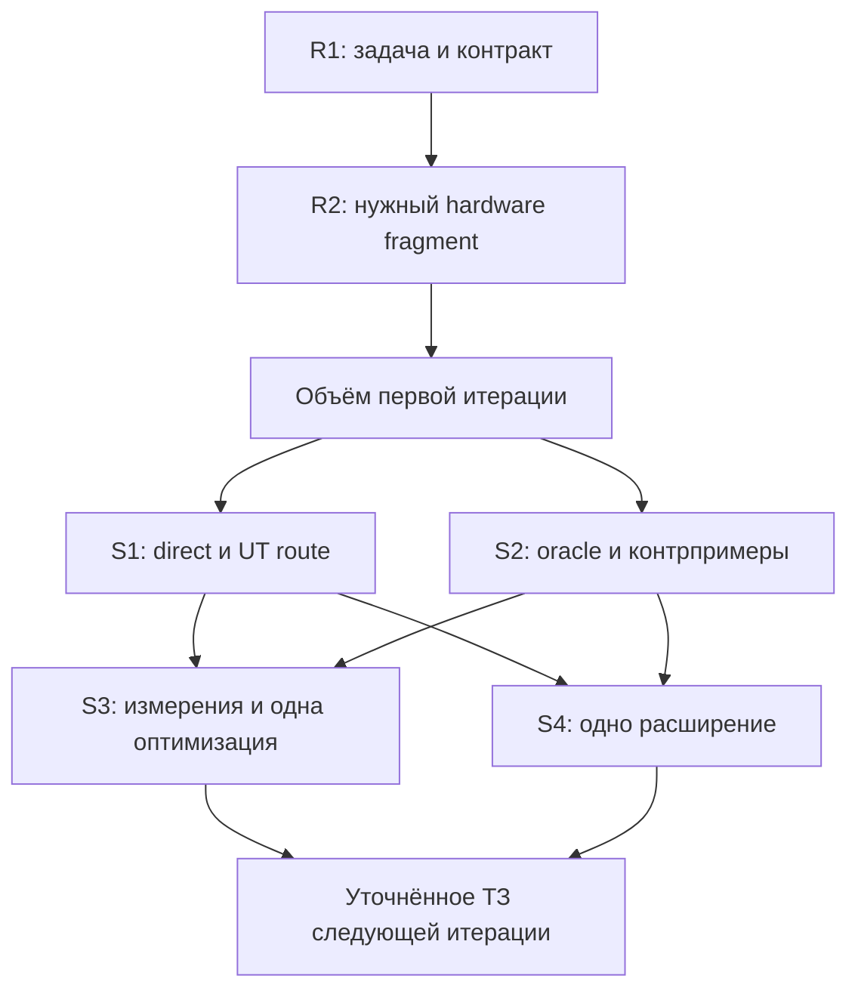

# Какие исследования нужны перед ближайшим ТЗ UTS

**Статус: proposal, 2026-10-26.** Это программа принятия решений для первой численной итерации, а не утверждённое ТЗ, новый runtime contract или отчёт о выполненных аппаратных экспериментах. Исходники проверены на `111da9765433448e5ca8ed48303fd8e772110ecb`. Текущая архитектурная authority — [CURRENT_ARCHITECTURE_STATUS](../../../docs/CURRENT_ARCHITECTURE_STATUS.md).

Документ уточняет приоритеты [EXPERIMENT_PLAN](EXPERIMENT_PLAN.md). Он не создаёт параллельный roadmap и не требует завершить все [Q01–Q42](RESEARCH_ANSWERS.md) до начала разработки.

## 1. Решение: два предварительных исследования и четыре ранних этапа ТЗ

Чтобы зафиксировать реалистичный объём первой вычислительной итерации, нужно ответить на два вопроса:

1. **R1 — кому, для какой программы и с каким численным контрактом нужен результат?**
2. **R2 — какой конкретный compiler/runtime/device способен исполнить необходимый фрагмент?**

Технический план исследовательской итерации можно составлять уже сейчас. Полный ответ о скорости, цене расширений и форме будущего API появляется в первых этапах этого плана:

- **S1:** минимальная интеграция и границы runtime API;
- **S2:** независимый oracle, отрицательные случаи и воспроизводимость;
- **S3:** matched baseline и одна оптимизация полного графа;
- **S4:** полная стоимость одного расширения и решение о семантическом сервисе.

Не следует требовать победы UTS до разрешения написать первый adapter. Но и обещать stable device API, ускорение, общий semantic engine или поддержку GPU до соответствующего опыта нельзя. Результат каждого исследования — короткое решение, минимальный исполняемый материал и конкретное изменение требований.

## 2. Что уже достаточно известно

| Основание | Следствие для ближайшего ТЗ |
|---|---|
| Generic SDK имеет typed entry artifacts, transformations, passes, backends и factories | Первый численный пакет использует существующий путь; новый универсальный compiler framework не нужен |
| `LanguageCompiler` — единственный владелец выбора packages/providers/routes | Runtime не обнаруживает скрытые новые backend; program-level оптимизация действует внутри выбранной конфигурации |
| Обычный C# known-query control уже повторён: 12/12 decision assertions | Повтор такого toy-примера не поможет выбрать hardware-архитектуру; следующий опыт должен менять реальное вычисление |
| MLIR имеет interfaces, dialects и progressive lowering | Новизна не обосновывается отсутствием этих механизмов у MLIR |
| Историческое DSL evolution study не показало общего total-cost выигрыша | Считать всю стоимость, включая adapters, schemas, tests, docs и configuration |
| Structural metadata и trust labels не удостоверяют ложные premises | Unknown/untrusted/stale facts не разрешают зависимое преобразование |
| TensorRules пока выполняет shape/policy demonstration | Следующий срез должен возвращать численные значения, а не только описание формы |

Источники и границы этих выводов: [README](README.md), [RESEARCH_ANSWERS](RESEARCH_ANSWERS.md), [VALIDATION](VALIDATION.md). Предыдущий корпус остаётся датированным evidence. В этой дополнительной работе аппаратные gates не запускались.

## 3. R1 — задача, пользователь и семантический контракт

### Решение, которое требуется

Определить основной результат ближайшей итерации: практическое встраивание численного DSL в .NET-приложение либо ограниченный исследовательский прототип. У исследовательского прототипа тоже должен быть конкретный сценарий; отсутствие подтверждённого пользователя нельзя скрывать названием «product-market fit».

Рабочий кандидат — пакетная формула `map → elementwise stages → reduction`. Если реальная задача матричная, выбирать `matmul + bias + activation` сразу. Stencil/image workload остаётся альтернативой, а не второй обязательной веткой работ.

### Минимальная работа

Собрать одну карточку нагрузки: предполагаемый потребитель, исходная программа, характерные входы/выходы, распределение размеров, частота вызовов, повторное использование данных, допустимые расходы времени/памяти. Использовать существующую реализацию как исходный performance baseline, если она есть. При синтетических данных явно обозначить их статус.

Описать ограниченный semantic subset:

| Область | Что фиксируется до сравнения результатов |
|---|---|
| Операции и типы | Точный список, один основной числовой тип, conversions и accumulation dtype |
| Shapes/layouts | Rank, static/dynamic dimensions, допустимые strides, broadcasting и empty cases |
| Числа | Overflow, rounding, FMA/contraction, reassociation, reduction semantics, NaN/Inf/signed zero |
| Память | Владелец входов/выходов, разрешённая мутация, aliasing и момент завершения |
| Ошибки | Ошибка программы, неподдержанный subset, ошибка компилятора и инфраструктурный сбой |
| Наблюдения | Значения, обязательные ошибки/effects, требуемая область reproducibility |
| Приёмка | Критерий численного сравнения, целевой режим latency/throughput, memory/overhead budget |

Для первого опыта разумно проверить immutable input buffers, отдельные outputs и ограниченные shapes. Это кандидат ограничения доменного пакета, не изменение общего framework contract. Для integer можно сравнивать точные значения согласно выбранной модели overflow. Для FP заранее определить применимость absolute/relative/ULP критериев; отдельно обработать zero, NaN, infinities и near-cancellation в reductions. Произвольные `atol`/`rtol`, подобранные после просмотра результатов, не являются контрактом.

Минимальный corpus включает обычный случай, пустой/единичный вход, маленький и большой размеры, неудобный tail, shared intermediate и численно сложные значения. Неподдерживаемые layouts/effects проверяются отказом; их наличие в отрицательной таблице не требует реализации.

### Завершение и влияние на ТЗ

R1 завершено, когда карточка задачи, subset, ожидаемые результаты и критерии успеха допускают независимую проверку. Полный новый interpreter для этого предварительного этапа не обязателен: достаточно маленьких hand-computed cases и существующего reference, если он соответствует контракту.

- Реальная нагрузка существует — её распределение определяет приоритет операций и метрики.
- Нагрузки нет — первое ТЗ честно описывает исследовательский прототип; продуктовая полезность остаётся гипотезой.
- Требуется bitwise reproducibility — определить конкретную target scope и реализуемость; слово `strict` само её не обещает.
- Нужны mutation/aliasing/async — включать их только если без них задача теряет смысл; иначе оставить за subset.

**Выход R1:** одна карточка задачи, таблица semantic contract, замороженный небольшой corpus, baseline и acceptance thresholds. Thresholds берутся из задачи до treatment-измерений; отсутствие данных означает незавершённое поле, а не разрешение придумать произвольный процент ускорения.

Для честно обозначенного исследовательского прототипа допустимо зафиксировать: «Продуктовый performance threshold не установлен; обязательны correctness, воспроизводимое измерение и отдельное решение по результатам. Обещание ускорения не входит в приёмку». Это завершает постановку R1 для прототипа и не блокирует работу ожиданием отсутствующего SLA; продвижение конкретного speedup-требования остаётся отдельным решением.

## 4. R2 — аппаратная и инструментальная выполнимость

### Минимальный эксперимент

Одна машина, один CPU, один GPU и один основной stack. IREE с подходящим driver — первый кандидат по предыдущему обзору. Конкретная связка выбирается по R1 и доступному устройству. Наличие Intel Iris Xe в прежней инвентаризации ещё не является успешным compute probe.

1. Зафиксировать compiler/runtime revisions, OS, hardware/API/driver и выбранный adapter.
2. Проверить простой точный численный fixture, включая неудобный размер, например 257.
3. Проверить минимальный фрагмент **из R1**: vector add недостаточен, если задача зависит от неподтверждённого matmul, reduction или другого dtype.
4. Скомпилировать и действительно исполнить фрагменты на CPU и выбранном GPU; проверить readback независимым ожидаемым результатом.
5. Проверить unsupported case и диагностируемый отказ.
6. Удостоверить, что выполнен hardware GPU route. Software Vulkan adapter, CPU fallback, экспорт SPIR-V или compilation-only acceptance не засчитываются как GPU execution.

Compiler targets, runtime drivers и реальные devices проверяются раздельно: это разные уровни и в [IREE deployment model](https://iree.dev/guides/deployment-configurations/). Начальный compiler bridge может быть внешним процессом. [IREE C API](https://iree.dev/reference/bindings/c-api/) — отдельный кандидат для последующего встраивания и повторных calls; native embedding не требуется одновременно с CLI pilot.

### Завершение и влияние на ТЗ

Выход — воспроизводимый device receipt, два маленьких fixture, команды/версии, expected/actual observations и таблица `supported / unsupported / not tested` для нужного subset.

- Gate пройден — конкретная связка становится целевым окружением первой итерации.
- Gate не пройден — назвать blocker и выбрать ограниченный следующий шаг: совместимое окружение, другой подходящий stack либо CPU-first промежуточный milestone. Исходная цель CPU/GPU при этом остаётся незавершённой.
- Формат IR плохо выражает семантику R1 — изменить формат до замораживания public API.

**Предлагаемый лимит probe — один рабочий день исполнителя**, один закреплённый stack и одна обоснованная настройка при конкретном blocker. Это организационный предел исследования, не оценка срока всей реализации. По истечении лимита записать результат и решение; не превращать gate в бессрочное исправление драйверов. TPU/NPU требуют отдельного доступа и остаются за первым объёмом.

## 5. S1 — интеграция, повторные входы и lifetime

Этот spike входит в первые задачи ТЗ. Его цель — определить минимальный adapter и необходимую форму API на настоящем вычислении.

### Что уже позволяет текущий код

- `WithEntryArtifact` и `LanguageArtifactKind<T>` допускают собственный numerical program artifact. Для опыта достаточно embedded DSL через typed builder/records. Текстовый синтаксис добавляется при пользовательской необходимости через owning parser.
- `AddTransformer`, `AddPass`, `AddBackend` и session factories позволяют подключить verifier, exporter/compiler и executor как обычные contributions.
- Build и execution уже разделены; выбранные package/contract/session boundaries должны сохраняться.
- Старый Wist SSA→AIR duplication/spill gap не является prerequisite для этого отдельного numerical route.

### Конкретные неопределённости, обнаруженные в исходниках

| Наблюдение @ `111da976` | Что проверяет spike |
|---|---|
| `ExecuteBuilt` использует execution request, сохранённый при Build; новых arguments этот метод не принимает | Compile once → два запуска с разными входными buffers; оценить новый typed invocation через `Run` и bounded session cache либо минимальное дополнение canonical API |
| `Run/Transform/Execute` синхронны; lifetime gate учитывает возврат .NET-операции | Синхронный executor ждёт device completion и copy-out до возврата; общий async/fence API пока не нужен |
| `PerSession` определяет lifetime, но не делает adapter автоматически reentrant | Один execution stream на session либо явная синхронизация; отдельные sessions независимы |
| `PlanHash` идентифицирует конфигурацию | Compiled-program identity учитывает program/numerical policy/shapes/layouts/compiler options/target отдельно |
| Generic limits не задают весь tensor allocation contract | Checked element-count/byte-count, memory cap и shape rejection до allocation |

Сохранённые request values имеют CLR reference semantics. Нельзя получать «новые входы» скрытой мутацией старого request и считать это разработанным контрактом. Синхронность текущего API сама по себе не блокирует GPU: корректный adapter может дождаться аппаратного завершения внутри `Execute`.

Проверить compile error, unsupported input, повторный вызов, new inputs, dispose во время операции и использование после dispose. Для внешнего процесса задать наблюдаемый timeout/cleanup. Отмена ожидания и гарантированная остановка уже отправленной аппаратной работы — разные обещания; первое не доказывает второе.

**Выход S1:** работающий минимальный direct bridge и UT route, sequence/lifetime contract, measured overhead breakdown и короткое решение о необходимых API changes. Различать пригодный экспериментальный adapter и готовность stable NuGet surface. Общие `DeviceBuffer`, streams/fences, persistent cache и универсальная tensor hierarchy остаются условными до этого опыта.

## 6. S2 — как проверять корректность и воспроизводить ошибки

Начинается вместе с S1; его минимальный oracle должен работать до интерпретации performance results.

Reference считает исходный semantic graph без исследуемых rewrites, schedule и effect-approval logic. Общий parser допустим, но source-to-IR отдельно проверяется hand-constructed cases. Пригодный correctness reference может быть медленным; performance baseline выбирается отдельно.

В PlanFuzz существующий `PlanFuzzObservationComparer` для успешных результатов использует точное `Equals` canonical snapshot. Для floating-point tolerance нужен отдельный numerical oracle с фиксированной политикой. Нельзя ослаблять exact oracle всех старых языков. Core `PlanFuzzOracleEngine` уже допускает явный registry; CLI `PlanFuzzReplayCoordinator` создаёт default engine, поэтому требуется проверить небольшую composition seam для регистрации нового oracle.

| Контроль | Приёмка |
|---|---|
| Намеренно неверный элемент или shape | Oracle отвергает результат и различает форму/значение |
| Значение внутри/снаружи заранее заданного допуска | Принимается/отвергается согласно R1, без подстройки допуска |
| NaN/infinity/signed zero | Не превращаются в универсальный PASS; правила явно заданы |
| Stale analysis / ложный effect claim | Зависимый rewrite не принимается без разрешённых оснований |
| Unsupported target или compiler failure | Отдельный outcome, не numerical success и не скрытая подмена CPU |
| Переполнение размера / memory bound / неприемлемый aliasing | Отказ до неподдержанного execution; вне subset сохраняется явный предел |
| Другая программа при том же LanguagePlan | Другая program identity; неподходящий compiled artifact не переиспользуется |
| Повторный запуск и replay | Seed, revisions, numeric policy, target и результаты достаточны для повторения |

S2 не обещает доказательство всех преобразований. Он задаёт наблюдаемый контракт и проверяет, что тестовая система обнаруживает конкретные намеренно внесённые ошибки. В infrastructure outcomes сохраняются различия `failed / timeout / unavailable / inconclusive`; отсутствие запуска не становится PASS.

**Выход S2:** независимый reference, numerical oracle, компактный positive/negative corpus, пример найденной и воспроизведённой ошибки. Продолжать существующий PlanFuzz, не создавать второй framework.

## 7. S3 — цена UTS и полезность оптимизации полного графа

Это два разных сравнения; их результаты нельзя смешивать.

### S3a. Framework overhead и ценность интеграции

Сравнить A: качественный обычный frontend → выбранный backend и B: тот же semantic frontend → UT typed route → тот же backend. У A должны быть нормальные интерфейсы и shared components; монолитный или намеренно слабый baseline недопустим.

Зафиксировать одинаковые compiler versions/options, numerical policy, target и данные. Сверить downstream IR/artifact либо объяснить различия. Если IR и backend одинаковы, оснований ждать от UTS более быстрого machine code нет. Здесь измеряется цена composition, verification, materialization и host orchestration, а полезность расширяемости проверяется в S4.

Общий code и tooling считаются симметрично; необходимые adapters и glue не исчезают из учёта только потому, что не меняют consumer.

### S3b. Одна законная глобальная оптимизация

Выбрать один вариант, например fusion двух стадий с устранением временного массива. Сравнить conservative/optimized plans. Тот же transform должен быть доступен direct baseline. Улучшение от IREE или от добавленного domain pass не приписывать исключительно UTS.

Проверить маленький/большой input, shared intermediate и один ограничивающий memory/layout/numeric случай. Если backend уже делает оптимизацию, это полезный результат: дублировать её в UTS не требуется.

Измерять compilation/materialization, first call, warm end-to-end, allocations/transfers/synchronization и peak memory; device-only время — дополнительная метрика. Разделять resident/nonresident режимы. Для integrated GPU нельзя автоматически подставлять модель дискретного устройства с PCIe: измеряется реальный data path. Публиковать повторения и разброс, чередовать A/B, фиксировать warmup и конкурирующую нагрузку. Маленькая выборка не обосновывает устойчивый p95. См. [IREE benchmarking](https://iree.dev/developers/performance/benchmarking/).

**Выход S3:** raw measurements, небольшой график/таблица и решение по acceptance budgets R1. Нет универсального заранее выдуманного порога «ускорить на X%».

- Overhead B укладывается в бюджет и есть ценность S4 — сохранять adapter.
- Overhead неприемлем — определить измеренный источник: process startup, data movement, materialization и т. п.; следующий шаг направить туда.
- GPU полезен на части размеров — оформить область применимости, не обещать выигрыш на всех inputs.
- Оптимизация не полезна — оставить baseline; большой tuner не следует из отрицательного результата.
- A проще и обеспечивает те же нужные гарантии — сузить UT integration; это допустимое инженерное решение.

## 8. S4 — расширяемость и условие возврата к semantic core

На работающих A/B заморозить прежний consumer и инфраструктуру. Добавить одно реалистичное operation/analysis extension через известный контракт и один небольшой lowering/schedule вариант, если он входит в выбранную задачу. Не изобретать новый fact domain только ради демонстрации broker.

Считать полную работу: changes в generic core, interfaces/schema, consumer/provider, registration, adapters, verifier, tests, docs и migration. LOC — вспомогательная метрика; также учитывать время при одинаковом tooling budget, обнаруженные ошибки, качество diagnostics и воспроизведение результата. Порядок работы A/B и эффект обучения обозначить; по возможности использовать заранее сохранённое расширение для проверки переноса результата.

Независимый внешний автор делает вывод сильнее. Если опыт выполнен тем же автором/моделью, явно назвать его author-designed; это позволяет принять локальное инженерное решение, но не доказывает качество независимой экосистемы.

**Выход S4:** inventory изменений A/B и решение о минимальных extension contracts.

- B полезен, ordinary typed queries достаточны — закрепить их; общего FactStore не добавлять.
- Несколько независимых consumers повторно используют одни факты и отзыв, а direct solution дублирует существенную работу — разрешить следующий отдельный pilot общего evidence service.
- Нужна только одна проверка или полный reanalysis дешевле — сохранить простое решение.
- Новая категория факта не имеет известного consumer hook — учесть стоимость нового transform/adapter; неизменность старого consumer не обещать автоматически.

Общий inference engine, exact invalidation DAG, persistent proof cache и перенос произвольных фактов между IR не являются условиями первого CPU/GPU slice.

## 9. Зависимости, бюджеты и правило остановки

Инвентаризацию R2 можно готовить параллельно R1, но окончательный fixture должен проверять нужный subset. S1 и S2 развиваются совместно. S3/S4 используют работающие реализации и один замороженный corpus.

Предварительная работа ограничивается одной workload family, одной CPU/GPU связкой и одним compiler stack. Для S1–S4 до начала назначается конкретный лимит времени и один ответственный; после лимита выдаётся `supported / rejected / inconclusive / blocked` с evidence и следующим решением. Не продлевать исследование только ради положительного результата. Неизвестный исход может сузить ТЗ, но не засчитывается как завершённая функция.

Сразу останавливать опасное преобразование при принятом неправильном результате; сохранять conservative execution, если он корректен. Проверять конкретную причину, а не добавлять общий broker или новую архитектуру как автоматический ответ на любой сбой.

## 10. Во что превратить результаты: каркас ближайшего ТЗ

Идентификаторы ниже — proposed requirements этой итерации, не новые текущие публичные обещания.

| ID | Требование | Когда можно фиксировать | Минимальная приёмка |
|---|---|---|---|
| NUM-01 | Один numerical language/domain package с ограниченным typed IR | После R1 | Верные случаи принимаются, неподдержанные shapes/types/effects отклоняются |
| NUM-02 | Численный контракт и независимый reference | После R1 | Hand-computed cases и пограничные входы соответствуют объявленной семантике |
| BACK-01 | Закреплённый compiler bridge с verifier и diagnostics | После R2; API уточняет S1 | Реальный artifact проходит verifier, неверный input не выдаётся за исполнимый |
| BACK-02 | CPU и один названный GPU route | GPU обязательство подтверждает R2 | Один corpus реально выполнен на обоих targets; target identity записана |
| RUN-01 | Повторный вызов с новыми входами и корректным reuse | После S1 | Два разных набора значений дают правильные разные результаты; compile reuse измерен, если заявлен |
| RUN-02 | Определённые completion, memory bounds и disposal | Conservative sync scope можно принять сразу | Возвращённый результат готов; in-flight resources не освобождаются преждевременно |
| VERIFY-01 | Numerical PlanFuzz adapter/oracle и replay | После R1, реализуется S2 | Seeded value/shape/tolerance faults обнаруживаются; старые exact oracles сохраняют контракт |
| ID-01 | Отдельные configuration и program/artifact identities | Можно зафиксировать сейчас | Другие program/policy/target не используют неподходящий artifact; выбранный plan не перепланируется runtime |
| PERF-01 | Matched A/B receipt и overhead budget | Протокол после R1, результат S3 | Одинаковые возможности и версии, end-to-end результаты и разброс опубликованы |
| OPT-01 | Один полезный program-level transform | Только по S3 либо как явно исследуемый кандидат | Legality проверена, положительные и отрицательные случаи есть, полезность измерена |
| EXT-01 | Одно расширение через package-owned contracts | После S4 | Зафиксированы все integration edits и сохранены действующие потребители в заявленном scope |
| CORE-01 | Общий semantic evidence service | Условно, после наблюдаемой потребности S4 | Второй независимый consumer, реальное преобразование, сравнение с typed-query control |

Если пользовательскому сценарию не нужен текстовый синтаксис, NUM-01 может начинаться с embedded typed DSL. Синтаксис сам по себе не проверяет полезность аппаратного пути. Если текстовый DSL нужен, parser/AST ownership остаётся обязательным.

### Когда ТЗ достаточно конкретно

Каждое обязательное требование имеет: пользовательскую причину, источник решения, supported subset, owner, положительный и отрицательный acceptance case, окружение проверки, зависимости и условие отката/сокращения. Для performance — фиксированную метрику и бюджет; для hardware — реально названный target; для API — определённый lifetime.

Не оставлять обязательными формулировки «реализовать семантическое ядро», «максимальная оптимизация» или «поддержать разные процессоры» без этих полей. Открытый вопрос преобразуется в ограниченный spike с заранее описанным влиянием его исхода на scope.

## 11. Что не включать в предварительный критический путь

- Закрытие всех Q01–Q42, E1–E8, M0–M6 и S0–S8 старого dossier.
- Новый повтор 12-case C# control или исторической модели с 18 081 decisions.
- Ещё один общий prior-art обзор вместо проверки выбранного workload.
- Завершение Wist SSA→AIR spills/local CSE перед отдельным numerical route.
- Большой grammar/type-system workbench, LSP, universal tensor hierarchy.
- Общие theorem store, Datalog, proof serialization и selective invalidation.
- Все GPU/TPU/NPU, mixed-device placement, persistent distributed cache.
- Большой autotuner/e-graph/learned cost model до полезного выбора между двумя планами.
- Publication-scale доказательство научной новизны или превосходства PlanFuzz.

Эти направления остаются возможными отдельными решениями. Ближайшее ТЗ должно вырасти из одного проверенного вычислительного пути и полной стоимости его расширения.

## 12. Source anchors для обнаруженных API-границ

- [Build bindings и ExecuteBuilt](../../../UniversalToolchain/UniversalToolchain.Runtime/ArtifactBuildContracts.cs), [saved execution request](../../../UniversalToolchain/UniversalToolchain.Runtime/LanguageArtifactBuildPipeline.cs).
- [Synchronous executor contracts](../../../UniversalToolchain/UniversalToolchain.Runtime/RuntimeContracts.cs), [runtime lifetime gate](../../../UniversalToolchain/UniversalToolchain.Runtime/RuntimeLifetimeGate.cs).
- [Exact observation comparison](../../../UniversalToolchain/UniversalToolchain.PlanFuzz.Core/PlanFuzzObservationComparer.cs), [value snapshot](../../../UniversalToolchain/UniversalToolchain.PlanFuzz.Core/PlanFuzzValueSnapshot.cs), [oracle registry](../../../UniversalToolchain/UniversalToolchain.PlanFuzz.Core/PlanFuzzOracleEngine.cs), [CLI composition seam](../../../UniversalToolchain/UniversalToolchain.PlanFuzz.Cli/PlanFuzzReplayCoordinator.cs).
- [Package manifest schema v5](../../../UniversalToolchain/UniversalToolchain.FeatureSdk/LanguageFeatureManifestSerializer.cs) и [LanguagePlan lock schema v6](../../../UniversalToolchain/UniversalToolchain.LanguageSdk/LanguageLockFile.cs) — разные форматы. Их версии нельзя обновлять механической общей заменой.
- [MLIR Toy tutorial](https://mlir.llvm.org/docs/Tutorials/Toy/) — первичный пример собственного языка, generic interfaces и lowering; он помогает определить сильный direct baseline, но не является выполненным здесь сравнением.
- [MLIR effects/speculation](https://mlir.llvm.org/docs/Rationale/SideEffectsAndSpeculation/) — первичный источник для различения memory effects и допустимости speculation; собственный subset UTS всё равно требует контракта R1.
